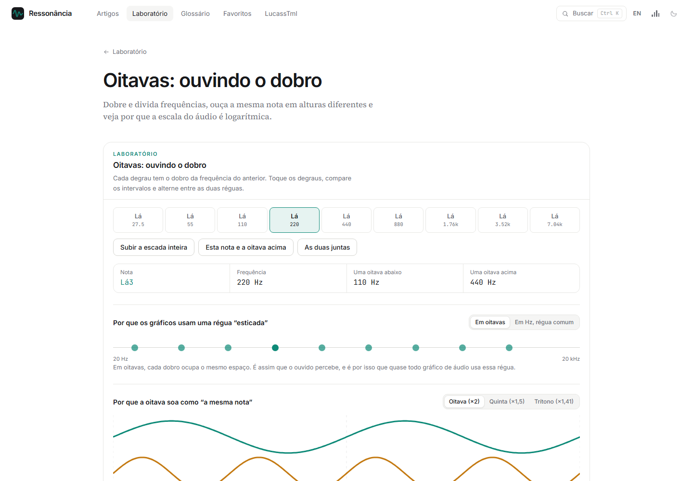
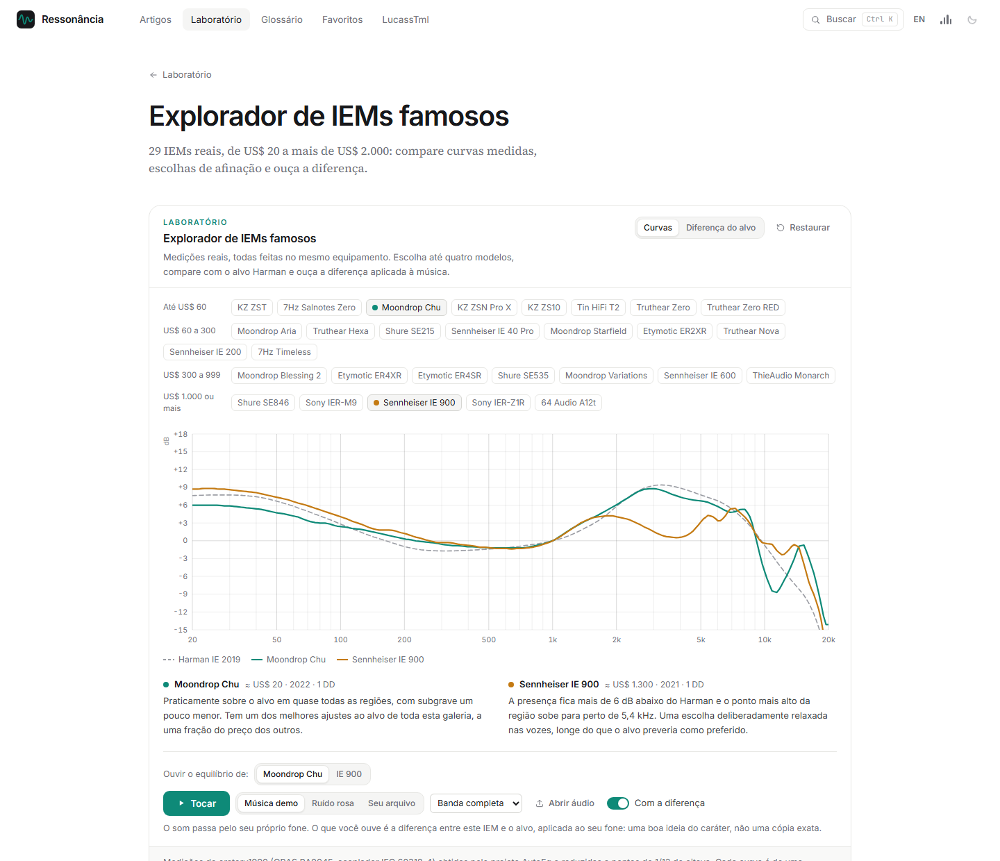
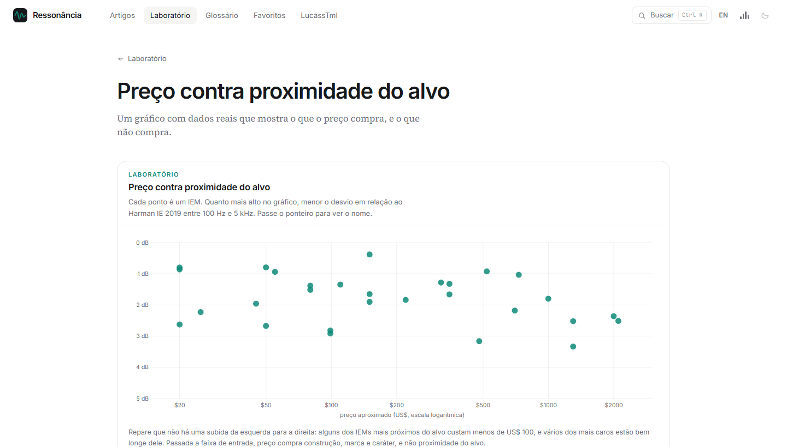

# Ressonância

**Uma enciclopédia interativa sobre som, audição e fones de ouvido, em português e inglês.**

O Ressonância explica áudio da física de uma onda até a escolha de um IEM, e deixa você ouvir cada ideia enquanto lê. Quem está começando encontra explicações simples e sem matemática. Quem quer ir fundo encontra artigos completos, com fórmulas a um clique e referências verificáveis.

Os experimentos fazem contas e processam áudio de verdade no navegador. Sem cadastro, sem quizzes e sem enviar nada a servidores.

| 11 módulos | 71 artigos | 49 laboratórios | 29 IEMs medidos |
| :---: | :---: | :---: | :---: |

## Do básico ao técnico

O módulo “Comece aqui” apresenta o essencial: o que são hertz, oitavas e decibéis, como ler um gráfico e como escolher o primeiro IEM. Os demais cobrem percepção, resposta em frequência, drivers, eletrônica, áudio digital, equalização e pensamento crítico.

## Para ver e ouvir

Cada conceito tem um experimento por perto. Aqui, as oitavas: cada degrau dobra a frequência, e dá para ouvir por que todos soam como a mesma nota.

No laboratório de resposta em frequência, você arrasta a curva, compara com alvos como o Harman e ouve o resultado aplicado à música.

## IEMs famosos, com medições reais

Uma galeria de 29 modelos, de cerca de US$ 20 a mais de US$ 2.000, todos medidos no mesmo equipamento. Dá para comparar curvas, entender as escolhas de afinação e ouvir a diferença.

E os dados rendem uma descoberta: pagar mais não aproxima um fone do alvo.

## Também no site

- Sons de fundo personalizáveis para a leitura, que pausam quando um experimento toca
- Glossário com definições dentro do texto, busca e favoritos
- Tema claro ou escuro
- Volume limitado e aviso de proteção auditiva nos experimentos

## Créditos

Curvas-alvo e medições de IEMs vêm do projeto [AutoEq](https://github.com/jaakkopasanen/AutoEq) (© Jaakko Pasanen, licença MIT); as medições de IEMs são de oratory1990.

Feito por [LucassTml](https://github.com/LucassTml).
