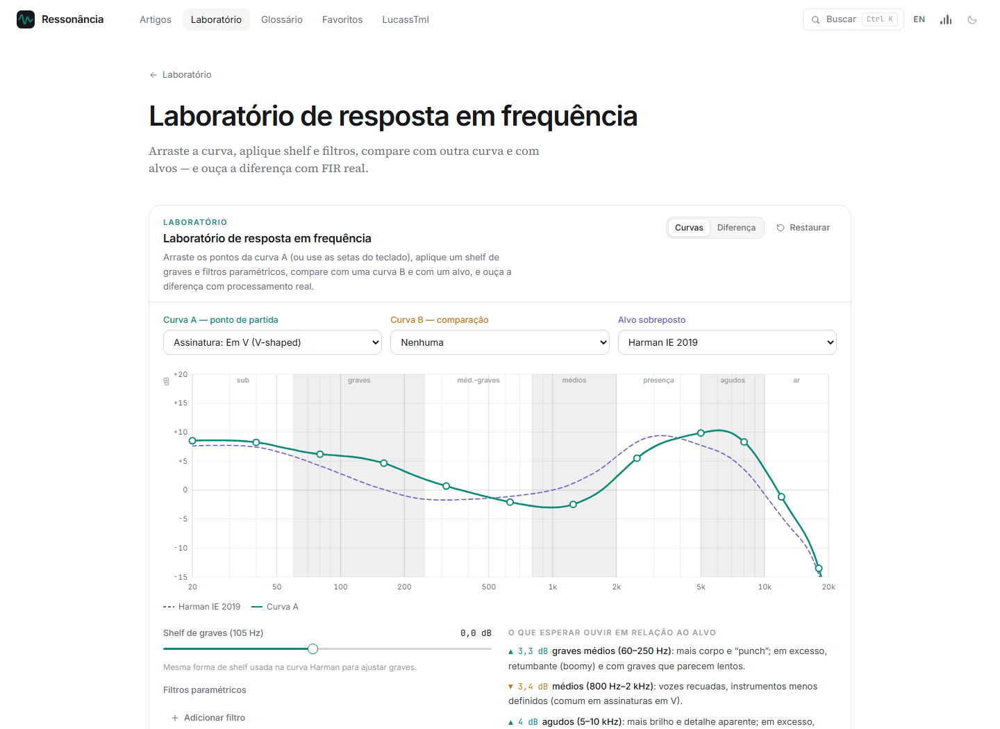

# Ressonância

**Uma enciclopédia interativa sobre som, audição e fones de ouvido, em português e inglês.**

O Ressonância explica áudio da física de uma onda até a escolha de um IEM, e deixa você ouvir cada ideia enquanto lê. Quem está começando encontra explicações simples e sem matemática. Quem quer ir fundo encontra artigos completos, com fórmulas a um clique e referências verificáveis.

Os experimentos fazem contas e processam áudio de verdade no navegador. Sem cadastro, sem quizzes e sem enviar nada a servidores.

| 11 módulos | 71 artigos | 49 laboratórios | 29 IEMs medidos |
| :---: | :---: | :---: | :---: |

## Do básico ao técnico

O módulo “Comece aqui” apresenta o essencial: o que são hertz, oitavas e decibéis, como ler um gráfico e como escolher o primeiro IEM. Os demais cobrem percepção, resposta em frequência, drivers, eletrônica, áudio digital, equalização e pensamento crítico.

## Laboratório de frequência

Arraste a curva, compare com alvos como o Harman e ouça o resultado aplicado à música.

## Também no site

Galeria de IEMs famosos com medições reais, explorador para comparar curvas, gráfico de preço contra proximidade do alvo, laboratório de oitavas e dezenas de outros experimentos. Há ainda sons de fundo para a leitura, glossário, busca, favoritos e tema escuro.

## Créditos

Curvas-alvo e medições de IEMs vêm do projeto [AutoEq](https://github.com/jaakkopasanen/AutoEq) (© Jaakko Pasanen, licença MIT); as medições de IEMs são de oratory1990.

Feito por [LucassTml](https://github.com/LucassTml).
